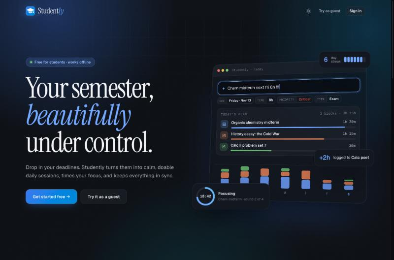
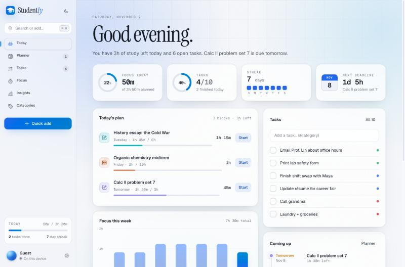

<h2 align="center"><em><code>Studently</code></em></h2>

<p align="center">Your semester, beautifully under control.</p>

Studently turns deadlines into a calm daily plan. Add what's due, and it splits the work into daily study blocks, times your focus sessions, and logs progress back to the right deadline.





## By the numbers

| | |
| --- | --- |
| **14** plan templates · **81** built-in milestones | research papers, AP / SAT prep, lab reports, college apps and more |
| **16** study techniques · **4** categories | active recall, spaced repetition, Feynman, interleaving… |
| **6** focus timer presets | Pomodoro, Deep work, Ultradian, 52/17, Sprint, Review |
| **30** achievements · **3** tiers | focus, streaks, deadlines, tasks and habits |
| **8** key metrics · **26**-week heatmap · **3** charts | on-time rate, estimate accuracy, peak focus hour… |
| **15**-minute planning blocks · **4** priority levels | inside a daily study budget you set |
| **7** accent colors × **3** themes × **5** fonts | the favicon re-colors to match |

## Features

- **Smart planner**: spreads each deadline's remaining hours across the days you have, most urgent first, inside a daily study budget. Time you've already focused today comes out of today's budget. It warns you early when a deadline won't fit or is overdue, with one-tap fixes.
- **Plan templates**: pick one of 14 templates, set the final date and effort level (light, standard, heavy), and every milestone is dated and scheduled. If you're short on time, the steps are packed closer together.
- **Natural-language quick add**: `Chem midterm next fri 8h !!!` becomes an exam due next Friday, 8 hours, critical priority. Understands `tomorrow`, weekdays, `next tue`, `nov 20`, `12/15`, `in 5 days`, `3h`, `90m`, `!`/`!!`/`!!!`, `p1`–`p3` and `#category`.
- **Focus timer**: 6 presets, breaks and rounds. Finished sessions log time to the deadline you picked, so the plan updates itself. Keeps running across views and reloads, with optional sound and desktop notifications.
- **Study technique library**: 16 methods with steps, what each is best for, and a matching timer preset.
- **Insights**: total focus, average session, longest streak, on-time rate, estimate accuracy, peak hour, a 26-week activity heatmap, and where your hours actually go.
- **Achievements**: 30 achievements in bronze, silver and gold, each with live progress.
- **Tasks and categories**: color-coded boards, inline editing, search, filters, and undo for deletes.
- **Command palette**: press `⌘K` / `Ctrl+K` to jump anywhere, search, or add tasks and deadlines.
- **Sync or go guest**: sign in with email or Google to sync through Firebase with offline support, or try it as a guest. Guest data moves into your account when you sign up.
- **Your data**: export and import JSON backups, or load a sample semester to explore.

## Keyboard shortcuts

| Keys        | Action                   |
| ----------- | ------------------------ |
| `⌘K`        | Command palette          |
| `N` or `/`  | Quick add                |
| `1`–`6`     | Switch views             |
| `T`         | Toggle theme             |
| `Space`     | Start / pause (Focus)    |
| `,`         | Settings                 |

## Development

```bash
npm install
npm run dev
```

Built with SvelteKit 2, Svelte 5, Firebase Auth + Firestore, and Lucide icons.
